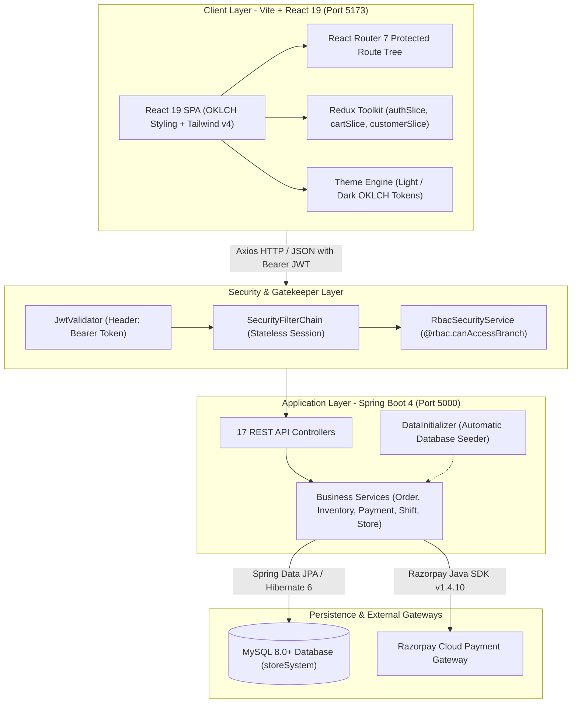
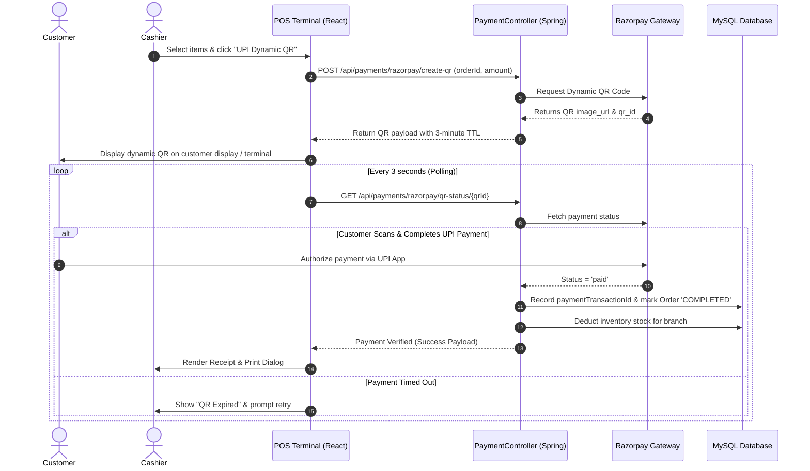
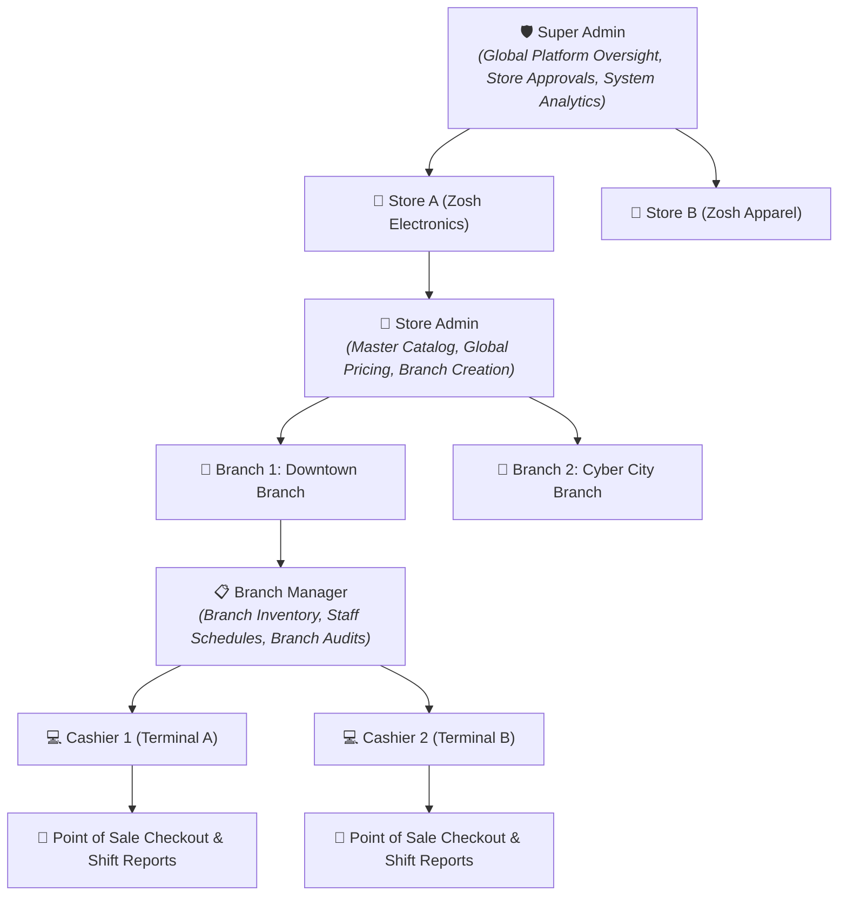
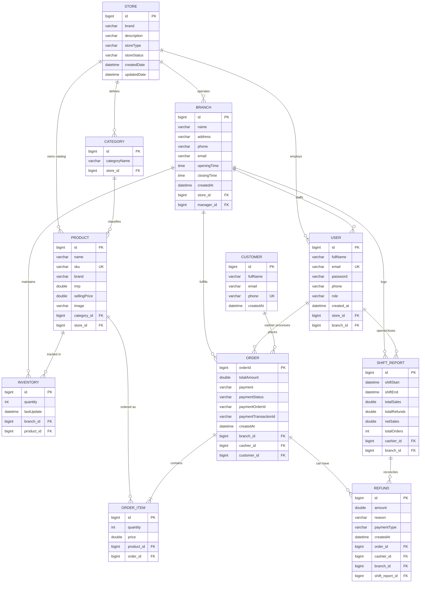

<div align="center">

# ⚡ ZOSH POS SYSTEM

### *Enterprise Multi-Store Retail Management, Inventory Control & Point of Sale Platform*

[](https://www.oracle.com/java/)
[](https://spring.io/projects/spring-boot)
[](https://react.dev/)
[](https://vitejs.dev/)
[](https://tailwindcss.com/)
[](https://www.mysql.com/)
[](https://razorpay.com/)
[](https://jwt.io/)
[](LICENSE)

<br/>

<p align="center">
  <b>A full-stack, enterprise-grade retail POS and multi-store management ecosystem. Engineered with Spring Boot 4, React 19, and Tailwind CSS v4, ZOSH POS features multi-tenant store hierarchies, strict method-level Role-Based Access Control (RBAC), real-time branch inventory tracking, multi-tender split payments with Razorpay Dynamic UPI QR codes, cashier shift reconciliation, and comprehensive analytics.</b>
</p>

[System Architecture](#-system-architecture) •
[Key Modules & Features](#-key-modules--features) •
[Role-Based Access Control](#-role-based-access-control-rbac) •
[Database Schema & ER Model](#-database-schema--entity-relationship-model) •
[REST API Reference](#-complete-rest-api-reference) •
[Demo Accounts](#-pre-seeded-demo-accounts) •
[Quick Start & Installation](#-installation--quick-start) •
[Configuration](#%EF%B8%8F-environment-configuration) •
[Troubleshooting](#-troubleshooting--faq)

</div>

---

## 📖 Table of Contents

- [Overview & Value Proposition](#-overview--value-proposition)
- [System Architecture](#-system-architecture)
  - [High-Level 3-Tier Architecture](#high-level-3-tier-architecture)
  - [Payment Lifecycle & Dynamic QR Flow](#payment-lifecycle--dynamic-qr-flow)
  - [Multi-Store Tenant Hierarchy](#multi-store-tenant-hierarchy)
- [Key Modules & Features](#-key-modules--features)
  - [1. Point of Sale (POS) Terminal](#1-point-of-sale-pos-terminal)
  - [2. Multi-Tender & Razorpay Dynamic QR Payments](#2-multi-tender--razorpay-dynamic-qr-payments)
  - [3. Cashier Shift & Cash Drawer Balancing](#3-cashier-shift--cash-drawer-balancing)
  - [4. Real-Time Branch Inventory Management](#4-real-time-branch-inventory-management)
  - [5. Refunds & Return Processing](#5-refunds--return-processing)
  - [6. Customer Relationship Management (CRM)](#6-customer-relationship-management-crm)
  - [7. Analytics, Shift Reporting & Dashboards](#7-analytics-shift-reporting--dashboards)
- [Role-Based Access Control (RBAC)](#-role-based-access-control-rbac)
  - [RBAC Permission Matrix](#rbac-permission-matrix)
  - [Security Architecture & Implementation](#security-architecture--implementation)
- [Database Schema & Entity-Relationship Model](#-database-schema--entity-relationship-model)
  - [Mermaid ER Diagram](#mermaid-er-diagram)
  - [Core Database Entities & Enums](#core-database-entities--enums)
- [Tech Stack](#-tech-stack)
- [Pre-Seeded Demo Accounts](#-pre-seeded-demo-accounts)
- [Complete REST API Reference](#-complete-rest-api-reference)
  - [Authentication API](#1-authentication-api-auth)
  - [Point of Sale & Orders API](#2-orders-api-apiorders)
  - [Payment & Razorpay API](#3-razorpay-payments-api-apipaymentsrazorpay)
  - [Shift & Drawer Reconciliation API](#4-shift-report-api-apishiftreport)
  - [Refunds API](#5-refunds-api-apirefunds)
  - [Catalog & Products API](#6-products-api-apiproducts)
  - [Categories API](#7-categories-api-apicategories)
  - [Branch Inventory API](#8-inventory-api-apiinventories)
  - [Customers CRM API](#9-customers-api-apicustomers)
  - [Employees Management API](#10-employees-api-apiemployees)
  - [Branch Management API](#11-branches-api-apibranches)
  - [Store Administration API](#12-store-management-api-apistore)
  - [Role-Specific Portals API](#13-role-specific-portals-api)
- [Installation & Quick Start](#-installation--quick-start)
  - [Prerequisites](#1-prerequisites)
  - [Database Setup](#2-database-setup)
  - [One-Click Windows Launcher](#3-one-click-launch-windows)
  - [Manual Terminal Launch](#4-manual-terminal-launch)
- [Environment Configuration](#%EF%B8%8F-environment-configuration)
  - [Backend Variables (`.env`)](#backend-zosh-pos-systemenv)
  - [Frontend Variables (`.env`)](#frontend-zosh-frontend-pos-systemzosh-pos-frontendenv)
- [Project Directory Structure](#-project-directory-structure)
- [Troubleshooting & FAQ](#-troubleshooting--faq)
- [License](#-license)

---

## 🌟 Overview & Value Proposition

**ZOSH POS** is a modern, high-speed retail checkout and store administration platform designed to solve operational bottlenecks for businesses ranging from single retail boutiques to multi-branch regional chains.

### Core Problems Solved:
1. **Speed at the Checkout Counter:** Instant SKU and name search, zero-latency barcode scanning support, keyboard shortcuts, and instant cart calculations prevent cashier queues.
2. **Payment Failure & Friction:** Native support for Cash, Card, UPI, and **Razorpay Dynamic UPI QR** with real-time payment auto-polling, expiration timers, and a built-in simulation engine for offline/test environments.
3. **Inventory Discrepancies:** Centralized master product catalog managed at the store level, paired with branch-specific floor inventory stock quantities, low-stock safety alerts, and automatic stock deduction upon checkout.
4. **Shift Theft & Drawer Balancing:** Cashiers must open shifts with cash float counts. All sales tenders (Cash, Card, UPI, Razorpay) and item returns are tracked in real-time, producing automated shift balance audits upon closing.
5. **Multi-Store Hierarchy:** Clear organizational hierarchy separating Platform Governance (Super Admin), Franchise / Brand Management (Store Admin), Local Store Operations (Branch Manager), and Checkout Operations (Cashiers).

---

## 🏗️ System Architecture

### High-Level 3-Tier Architecture



---

### Payment Lifecycle & Dynamic QR Flow

The dynamic QR payment lifecycle enables customers to pay with any UPI application (Google Pay, PhonePe, Paytm, BHIM) directly at the counter:



---

### Multi-Store Tenant Hierarchy



---

## 💻 Tech Stack

### Frontend Architecture
| Layer | Technologies & Libraries | Purpose |
| :--- | :--- | :--- |
| **Framework & Core** | **React 19.3.1**, **Vite 8.3.5** | Modern, fast build tooling with React Server/Concurrent feature support |
| **Routing** | **React Router 7.18.5** | Declarative nested routing, role-protected layouts, and navigation guards |
| **Styling & CSS** | **Tailwind CSS v4.3.3**, `@tailwindcss/vite` | Utility-first next-gen engine powered by native CSS OKLCH color palettes |
| **UI Components** | `@base-ui/react`, `shadcn`, `class-variance-authority` | Accessible, unstyled primitives styled with custom theme tokens |
| **State Management**| `@reduxjs/toolkit 2.13.0`, `react-redux` | Centralized state slices for `auth`, `cart`, and `customer` |
| **Data Visualization**| **Recharts 3.10.1** | Responsive charts for hourly sales, revenue distribution, and shift trends |
| **Form Handling** | `react-hook-form 7.91`, `zod 4.6.7` | High-performance schema-validated form workflows |
| **Icons & FX** | `lucide-react`, `tw-animate-css` | Clean vector iconography and micro-interactions |

### Backend Architecture
| Layer | Technologies & Libraries | Purpose |
| :--- | :--- | :--- |
| **Core Framework** | **Spring Boot 4.1.1** | Production-ready enterprise Java application framework |
| **Language** | **Java 21 LTS** | Modern Java with records, pattern matching, and virtual thread readiness |
| **Security** | **Spring Security 6**, `io.jsonwebtoken (jjwt 0.13.0)` | Stateless JWT authentication, custom RBAC filter, BCrypt password hashing |
| **Data Persistence**| **Spring Data JPA**, **Hibernate 6** | Declarative ORM repositories, entity graphs, and automated DDL schema generation |
| **Database** | **MySQL 8.0+** | Relational data persistence with HikariCP connection pooling |
| **Payment Gateway** | **Razorpay Java SDK 1.4.10**, **Stripe SDK 34.0** | Enterprise payment order creation, dynamic UPI QR generation, and signature verification |
| **Utilities** | **Project Lombok** | Eliminates boilerplate getters, setters, builders, and loggers |

---

## 👥 Role-Based Access Control (RBAC)

ZOSH POS enforces a strict 4-tier hierarchical access model. Protection is implemented at both the **Spring Security filter chain**, **method-level annotations (`@PreAuthorize`)**, and the **frontend route guards (`<ProtectedRoute />`)**.

### RBAC Permission Matrix

| Module / Operation | Super Admin | Store Admin | Branch Manager | Cashier |
| :--- | :---: | :---: | :---: | :---: |
| **Platform Management & Store Status** | ✅ Full | ❌ Denied | ❌ Denied | ❌ Denied |
| **User Role Assignment** | ✅ Full | ❌ Denied | ❌ Denied | ❌ Denied |
| **Create & Configure Stores** | ✅ Full | ✅ Own Store | ❌ Denied | ❌ Denied |
| **Create & Configure Branches** | ✅ Full | ✅ Own Store | ❌ Denied | ❌ Denied |
| **Master Product & Category Catalog** | ✅ Full | ✅ Own Store | 👁️ Read-Only | 👁️ Read-Only |
| **Branch Inventory Adjustments** | ✅ Full | ✅ All Branches | ✅ Own Branch | ❌ Denied |
| **Staff & Employee Management** | ✅ Full | ✅ Store Staff | ✅ Branch Cashiers | ❌ Denied |
| **Point of Sale Terminal (Checkout)** | ✅ Full | ✅ Allowed | ✅ Allowed | ✅ Primary User |
| **Process Refunds & Item Returns** | ✅ Full | ✅ Full | ✅ Own Branch | ✅ Assigned Shift |
| **Start & Close Shift Reports** | ✅ Full | 👁️ View Reports | 👁️ View Branch Reports | ✅ Own Register |
| **Customer Directory & CRM** | ✅ Full | ✅ Store-Wide | ✅ Branch-Wide | ✅ Search & Add |
| **Financial & Sales Analytics** | ✅ Global | ✅ Store-Wide | ✅ Branch-Wide | 👁️ Personal Metrics |

### Security Architecture & Implementation

1. **Stateless JWT Provider (`JwtProvider.java`):**
   - Issues signed JWT tokens using HMAC-SHA256 (`Keys.hmacShaKeyFor`) with embedded user email and role claims.
   - Tokens are validated per-request without storing session state in server memory.
2. **JWT Validator Filter (`JwtValidator.java`):**
   - Intercepts requests, extracts the `Authorization: Bearer <token>` header, parses authorities, and sets the `SecurityContextHolder`.
3. **Dynamic RBAC Service (`RbacSecurityService.java`):**
   - Exposed as `@rbac` in Spring Expression Language (SpEL) expressions.
   - Verifies whether the authenticated user owns or is assigned to the requested branch or store:
     ```java
     @PreAuthorize("@rbac.canAccessBranch(#branchId)")
     @GetMapping("/today/branch/{branchId}")
     public ResponseEntity<List<OrderDto>> getOrdersByTodayBranchId(@PathVariable Long branchId) { ... }
     ```

---

## 📦 Key Modules & Features

### 1. Point of Sale (POS) Terminal
- **Fast Two-Pane Layout:** Left catalog pane with instant category tabs, keyword search, SKU search, and stock status indicators. Right cart pane displaying active items, quantity modifiers, line totals, and tax breakdowns.
- **Dynamic Pricing & Tax Engine:** Automated subtotal calculation, configurable GST/sales tax slabs, line-item discounts, and final rounding.
- **Stock Guard:** Real-time stock validation prevents adding items exceeding available branch inventory.
- **Quick Customer Lookup:** Fast auto-complete search by phone number or name; one-click popup modal to register new customers without leaving the checkout flow.
- **Thermal Receipt Printing:** Produces formatted, printer-ready receipts displaying store info, cashier name, tax invoice number, itemized lines, and payment reference.

### 2. Multi-Tender & Razorpay Dynamic QR Payments
- **Payment Tenders Supported:** `CASH`, `CARD`, `UPI`, and `RAZORPAY`.
- **Dynamic UPI QR Code:** Generates dynamic Bharat QR codes tied to the exact order amount with a 3-minute expiration countdown timer.
- **Auto-Polling Engine:** Frontend automatically polls the payment status endpoint (`/api/payments/razorpay/qr-status/{qrId}`) every 3 seconds until verified.
- **Sandbox Simulation Mode:** Features a built-in simulation button (`/api/payments/razorpay/simulate-qr/{qrId}`) allowing developers and cashiers to test QR completion without real fund deduction.
- **Webhook Integration:** Validates inbound Razorpay payment signature notifications for headless, asynchronous reconciliations.

### 3. Cashier Shift & Cash Drawer Balancing
- **Shift Opening:** Cashiers initiate their shift with an opening cash float amount (`/api/shiftReport/start`).
- **Real-Time Shift Tracker:** Tracks cash sales, digital tender sales, total transactions, and refunded amounts as orders are processed.
- **Shift Reconciliation Report:** When closing a shift (`/api/shiftReport/end`), the system calculates:
  $$\text{Net Sales} = \text{Total Sales} - \text{Total Refunds}$$
  $$\text{Expected Cash in Drawer} = \text{Opening Float} + \text{Cash Sales} - \text{Cash Refunds}$$
- Produces an audit-ready breakdown of payment tenders and top-selling products during that shift.

### 4. Real-Time Branch Inventory Management
- **Store vs. Branch Catalog:** Master catalog is defined globally at the Store level (SKU, brand, description, MRP, image). Each Branch maintains its own stock quantity.
- **Real-Time Stock Updates:** Checkout operations atomically decrement inventory counts. Refunds increment stock back to floor inventory.
- **Safety Stock Thresholds:** Color-coded badges highlight items that are low in stock (below threshold) or out of stock.

### 5. Refunds & Return Processing
- **Granular Return Options:** Supports full order cancellations or individual item-level returns.
- **Restock Automation:** Automatically restores returned quantities back to the branch inventory repository.
- **Shift Audit Linkage:** Every refund is linked to the active cashier and current shift report to ensure register balance accuracy.

### 6. Customer Relationship Management (CRM)
- **Customer Profiles:** Tracks customer name, phone number, email, registration date, and order history.
- **Instant Search:** Instant search filter across customer lists by partial name or mobile number.
- **Checkout Linkage:** Orders can be attributed to specific customers for loyalty tracking and receipt history.

### 7. Analytics, Shift Reporting & Dashboards
- **Role-Specific Dashboards:** Custom tailored KPI cards for Super Admin, Store Admin, Branch Manager, and Cashier.
- **Visual Analytics:** Interactive Recharts visualizers including:
  - Daily & monthly sales revenue area charts.
  - Tender breakdown pie charts (Cash vs. UPI vs. Card vs. Razorpay).
  - Top 5 best-performing products by volume and revenue.
  - Cashier sales velocity comparison.

---

## 🗄️ Database Schema & Entity-Relationship Model

### Mermaid ER Diagram



### Core Database Entities & Enums

- **`StoreStatus`:** `ACTIVE`, `PENDING`, `BLOCKED`
- **`UserRoles`:** `ROLE_SUPER_ADMIN`, `ROLE_STORE_ADMIN`, `ROLE_MANAGER`, `ROLE_CASHIER` (with backward-compatible support for `ROLE_ADMIN`, `ROLE_BRANCH_MANAGER`, `ROLE_STORE_MANAGER`)
- **`OrderStatus`:** `PENDING`, `COMPLETED`, `CANCELED`
- **`PaymentType`:** `CASH`, `UPI`, `CARD`, `RAZORPAY`

---

## 🔑 Pre-Seeded Demo Accounts

The system automatically initializes default accounts, stores, branches, categories, products, and customers via `DataInitializer.java` on application startup.

| Role | Email / Login ID | Password | Portal View | Default Assignment |
| :--- | :--- | :--- | :--- | :--- |
| **Super Admin** | `admin@zoshpos.com` | `123456` | `/super-admin/dashboard` | Global Platform Governance |
| **Store Admin** | `storeadmin@zoshpos.com` | `123456` | `/store-admin/dashboard` | Zosh Retail Store (Flagship) |
| **Branch Manager**| `manager@zoshpos.com` | `123456` | `/manager/dashboard` | Main Branch - Sector 29 |
| **Cashier POS** | `cashier@zoshpos.com` | `123456` | `/cashier/pos` | Terminal A - Sector 29 |

> [!TIP]
> On the frontend **Login Screen** (`http://localhost:5173/auth/login`), quick-fill buttons are provided for each demo role. Clicking any button populates the credentials instantly.

---

## 📡 Complete REST API Reference

All protected API endpoints require an `Authorization` HTTP header formatted as:
```http
Authorization: Bearer <your_jwt_token>
```

### 1. Authentication API (`/auth`)

| Method | Endpoint | Description | Auth Required | Request Body |
| :--- | :--- | :--- | :---: | :--- |
| `POST` | `/auth/signup` | Register a new user / store owner | No | `{ "fullName": "...", "email": "...", "password": "...", "role": "..." }` |
| `POST` | `/auth/login` | Authenticate with email & password; returns JWT token | No | `{ "email": "...", "password": "..." }` |

---

### 2. Orders API (`/api/orders`)

| Method | Endpoint | Description | Auth Required | Role Level |
| :--- | :--- | :--- | :---: | :--- |
| `POST` | `/api/orders` | Create and place a new order (deducts stock) | Yes | Cashier / Manager / Admin |
| `GET` | `/api/orders` | Retrieve all orders across the system | Yes | Admin / Super Admin |
| `GET` | `/api/orders/{id}` | Retrieve single order details & line items | Yes | Authenticated Staff |
| `GET` | `/api/orders/branch/{id}` | Filter orders by branch with optional query params (`customerId`, `cashierId`, `paymentType`, `status`) | Yes | Branch / Store Staff |
| `GET` | `/api/orders/cashier/{cashierId}` | List orders processed by specific cashier | Yes | Cashier / Manager |
| `GET` | `/api/orders/today/branch/{id}` | Get all orders created today for a branch | Yes | `@rbac.canAccessBranch` |
| `GET` | `/api/orders/customer/{id}` | Retrieve complete order history for a customer | Yes | Staff |
| `GET` | `/api/orders/recent/{branchId}` | Get top 5 most recent orders for a branch | Yes | `@rbac.canAccessBranch` |

---

### 3. Razorpay Payments API (`/api/payments/razorpay`)

| Method | Endpoint | Description | Auth Required | Role Level |
| :--- | :--- | :--- | :---: | :--- |
| `GET` | `/api/payments/razorpay/config` | Get public Razorpay key ID, currency, and company name | Yes | Authenticated |
| `POST` | `/api/payments/razorpay/create-order` | Create an official Razorpay payment order | Yes | Cashier / Staff |
| `POST` | `/api/payments/razorpay/verify` | Verify Razorpay payment signature & update order | Yes | Authenticated |
| `POST` | `/api/payments/razorpay/create-qr` | Generate a dynamic UPI QR code with amount & order ID | Yes | Cashier / Staff |
| `GET` | `/api/payments/razorpay/qr-status/{qrId}` | Poll payment verification status for dynamic QR code | Yes | Authenticated |
| `POST` | `/api/payments/razorpay/simulate-qr/{qrId}` | Simulate instant payment approval for test/demo mode | Yes | Cashier / Staff |
| `POST` | `/api/payments/razorpay/webhook` | Webhook receiver for Razorpay asynchronous events | No (Public) | Webhook Signature |

---

### 4. Shift Report API (`/api/shiftReport`)

| Method | Endpoint | Description | Auth Required | Role Level |
| :--- | :--- | :--- | :---: | :--- |
| `POST` | `/api/shiftReport/start` | Open a new cashier shift and log opening time | Yes | Cashier / Staff |
| `PATCH` | `/api/shiftReport/end` | Close active shift, balance cash drawer, compute net sales | Yes | Cashier / Staff |
| `GET` | `/api/shiftReport/current` | Retrieve active shift progress and real-time sales tallies | Yes | Cashier / Staff |
| `GET` | `/api/shiftReport/cashier/{cashierId}` | Get historical shift reports for a cashier | Yes | Manager / Admin |
| `GET` | `/api/shiftReport/cashier/{cashierId}/by-date` | Get cashier shift report for a specific calendar date | Yes | Manager / Admin |
| `GET` | `/api/shiftReport/branch/{branchId}` | Get all shift reports for a branch | Yes | `@rbac.canAccessBranch` |
| `GET` | `/api/shiftReport/{id}` | Get detailed shift report summary by ID | Yes | Manager / Admin |
| `GET` | `/api/shiftReport` | Retrieve all system shift reports | Yes | Super Admin |

---

### 5. Refunds API (`/api/refunds`)

| Method | Endpoint | Description | Auth Required | Role Level |
| :--- | :--- | :--- | :---: | :--- |
| `POST` | `/api/refunds` | Process a refund, restock inventory, and link to shift | Yes | Cashier / Manager / Admin |
| `GET` | `/api/refunds` | Retrieve all refunds system-wide | Yes | Store Admin / Super Admin |
| `GET` | `/api/refunds/refundId/{refundId}` | Get refund record by primary ID | Yes | Staff |
| `GET` | `/api/refunds/cashierId/{cashierId}` | List refunds initiated by specific cashier | Yes | Manager / Admin |
| `GET` | `/api/refunds/branchId/{branchId}` | List refunds processed at a branch | Yes | Manager / Admin |
| `GET` | `/api/refunds/shiftRefundId/{shiftId}` | Get all refunds belonging to a specific shift report | Yes | Manager / Admin |
| `GET` | `/api/refunds/cashier/{cashierId}/range` | Get cashier refunds filtered by date range | Yes | Manager / Admin |
| `DELETE`| `/api/refunds/{refundId}` | Delete refund record (audit purposes) | Yes | Admin / Super Admin |

---

### 6. Products API (`/api/products`)

| Method | Endpoint | Description | Auth Required | Role Level |
| :--- | :--- | :--- | :---: | :--- |
| `GET` | `/api/products` | Retrieve all products across all stores | Yes | Staff |
| `POST` | `/api/products` | Create a new master catalog product | Yes | Store Admin / Super Admin |
| `GET` | `/api/products/store/{storeId}` | Get all products belonging to a specific store | Yes | Staff |
| `GET` | `/api/products/search?keyword=...`| Search catalog products by name, SKU, or brand | Yes | Staff |
| `PUT` | `/api/products/{id}` | Update product details, MRP, or selling price | Yes | Store Admin / Super Admin |
| `DELETE`| `/api/products/{id}` | Delete product from store catalog | Yes | Store Admin / Super Admin |

---

### 7. Categories API (`/api/categories`)

| Method | Endpoint | Description | Auth Required | Role Level |
| :--- | :--- | :--- | :---: | :--- |
| `GET` | `/api/categories/store/{storeId}` | Retrieve all product categories for a store | Yes | Staff |
| `POST` | `/api/categories` | Create a new product category | Yes | Store Admin / Super Admin |
| `PUT` | `/api/categories/{id}` | Update category name | Yes | Store Admin / Super Admin |
| `DELETE`| `/api/categories/{id}` | Delete category | Yes | Store Admin / Super Admin |

---

### 8. Inventory API (`/api/inventories`)

| Method | Endpoint | Description | Auth Required | Role Level |
| :--- | :--- | :--- | :---: | :--- |
| `GET` | `/api/inventories/branch/{branchId}` | Get real-time stock levels for all products at branch | Yes | Staff |
| `GET` | `/api/inventories/branch/{branchId}/product/{productId}` | Get stock quantity for a single product at branch | Yes | Staff |
| `POST` | `/api/inventories` | Assign initial inventory stock to a branch product | Yes | Manager / Store Admin |
| `PUT` | `/api/inventories/branch/{id}` | Update/adjust stock quantity for branch inventory item | Yes | Manager / Store Admin |
| `DELETE`| `/api/inventories/{id}` | Remove inventory tracking item | Yes | Store Admin / Super Admin |

---

### 9. Customers API (`/api/customers`)

| Method | Endpoint | Description | Auth Required | Role Level |
| :--- | :--- | :--- | :---: | :--- |
| `GET` | `/api/customers` | List all registered customers | Yes | Staff |
| `POST` | `/api/customers` | Register a new customer | Yes | Cashier / Staff |
| `GET` | `/api/customers/search?q=...` | Search customers by phone or name | Yes | Staff |
| `PUT` | `/api/customers/{id}` | Update customer contact information | Yes | Staff |
| `DELETE`| `/api/customers/{id}` | Delete customer profile | Yes | Admin / Super Admin |

---

### 10. Employees API (`/api/employees`)

| Method | Endpoint | Description | Auth Required | Role Level |
| :--- | :--- | :--- | :---: | :--- |
| `GET` | `/api/employees/store/{storeId}` | List all employees assigned to a store | Yes | Store Admin / Super Admin |
| `GET` | `/api/employees/branch/{branchId}` | List all cashiers & staff assigned to a branch | Yes | Manager / Store Admin |
| `POST` | `/api/employees/store/{storeId}` | Onboard new employee to store | Yes | Store Admin / Super Admin |
| `POST` | `/api/employees/branch/{branchId}` | Onboard new cashier to branch | Yes | Manager / Store Admin |
| `PUT` | `/api/employees/{employeeId}` | Update employee profile details | Yes | `@rbac.canModifyEmployee` |
| `DELETE`| `/api/employees/{employeeId}` | Deactivate or remove employee | Yes | Store Admin / Super Admin |

---

### 11. Branches API (`/api/branches`)

| Method | Endpoint | Description | Auth Required | Role Level |
| :--- | :--- | :--- | :---: | :--- |
| `GET` | `/api/branches/store/{storeId}` | List all branches belonging to a store | Yes | Store Staff |
| `GET` | `/api/branches/{id}` | Retrieve branch information, hours, and manager | Yes | Staff |
| `POST` | `/api/branches` | Create a new physical branch for a store | Yes | Store Admin / Super Admin |
| `PUT` | `/api/branches/{id}` | Update branch address, contact, operating hours | Yes | Store Admin / Super Admin |
| `DELETE`| `/api/branches/{id}` | Remove a branch | Yes | Store Admin / Super Admin |

---

### 12. Store Management API (`/api/store`)

| Method | Endpoint | Description | Auth Required | Role Level |
| :--- | :--- | :--- | :---: | :--- |
| `POST` | `/api/store` | Register new store brand / tenant | Yes | Store Admin / Super Admin |
| `GET` | `/api/store/{id}` | Get store details by ID | Yes | Authenticated |
| `GET` | `/api/store/admin` | Get current logged-in store admin's store | Yes | Store Admin |
| `GET` | `/api/store/employee` | Get store affiliated with logged-in employee | Yes | Employee |
| `PUT` | `/api/store/{id}` | Update store profile and description | Yes | Store Admin / Super Admin |
| `GET` | `/api/store/stores` | List all stores across the entire platform | Yes | Super Admin Only |
| `PUT` | `/api/store/{id}/moderate` | Approve, suspend, or activate store (`ACTIVE`/`BLOCKED`)| Yes | Super Admin Only |
| `DELETE`| `/api/store/{id}` | Delete store and associated data | Yes | Super Admin Only |

---

### 13. Role-Specific Portals API

#### Cashier Portal (`/api/cashier`)
- `GET /api/cashier/dashboard`: Aggregated personal metrics (total transactions, gross sales, active shift details, recent orders).
- `GET /api/cashier/shift-status`: Fast check verifying whether the cashier has an open, active shift float.

#### Branch Manager Portal (`/api/manager`)
- `GET /api/manager/dashboard`: Branch health metrics, today's gross sales, low-stock alerts, active cashier registers.
- `GET /api/manager/branch`: Current manager's branch profile.
- `GET /api/manager/inventory`: Live stock levels across all catalog products for the branch.
- `GET /api/manager/orders`: Complete chronological order stream for the branch.
- `GET /api/manager/cashiers`: Directory of cashiers assigned to the manager's branch.

#### Store Admin Portal (`/api/store-admin`)
- `GET /api/store-admin/dashboard`: Store-wide performance, total branches count, catalog volume, gross multi-branch revenue.
- `GET /api/store-admin/store`: Managed store brand profile.
- `GET /api/store-admin/branches`: Comprehensive directory of all store branches.
- `GET /api/store-admin/employees`: Global roster of all employees across all branches.

#### Super Admin Portal (`/api/super-admin`)
- `GET /api/super-admin/dashboard`: Global multi-tenant health, total registered stores, active users, platform GMV.
- `GET /api/super-admin/stores`: All stores across all states.
- `PUT /api/super-admin/stores/{id}/status`: Toggle store status (`ACTIVE`, `PENDING`, `BLOCKED`).
- `GET /api/super-admin/users`: Global system user directory.
- `PUT /api/super-admin/users/{id}/role`: Elevate or modify any user's role.

---

## 🚀 Installation & Quick Start

### 1. Prerequisites
Ensure you have the following installed on your machine:
- **Java Development Kit (JDK) 21 LTS:** [Download OpenJDK 21](https://adoptium.net/) (Verify with `java -version`)
- **Node.js (v18.x, v20.x, or v22.x) & npm:** [Download Node.js](https://nodejs.org/) (Verify with `node -v`)
- **MySQL Database Server 8.0+:** Running locally on port `3306`
- **Git:** For cloning and version management

---

### 2. Database Setup
Log into your MySQL command line client or MySQL Workbench and create the database:

```sql
CREATE DATABASE IF NOT EXISTS storeSystem CHARACTER SET utf8mb4 COLLATE utf8mb4_unicode_ci;
```

> [!NOTE]
> Hibernate will automatically generate all tables (`user`, `store`, `branch`, `product`, `orders`, `shift_report`, etc.) and the `DataInitializer` will automatically seed initial accounts on first startup.

---

### 3. One-Click Launch (Windows)

The repository includes a ready-to-use launch script in the project root:

```bat
start-project.bat
```

This batch script:
1. Detects your local JDK 21 installation (`JAVA_HOME`).
2. Opens a command window and boots the **Spring Boot backend** on `http://localhost:5000`.
3. Opens a second command window and starts the **Vite React frontend** on `http://localhost:5173`.

---

### 4. Manual Terminal Launch

#### Step A: Run Spring Boot Backend
```bash
# Navigate to the backend directory
cd zosh-pos-system

# Verify your .env file exists and points to your MySQL database
# (See Configuration section below)

# On Windows
.\mvnw.cmd spring-boot:run

# On Linux or macOS
chmod +x mvnw
./mvnw spring-boot:run
```
*Backend will be accessible at: `http://localhost:5000`*

#### Step B: Run React Frontend
```bash
# Navigate to the frontend directory
cd zosh-frontend-pos-system/zosh-pos-frontend

# Install dependencies
npm install

# Start Vite development server
npm run dev
```
*Frontend will be accessible at: `http://localhost:5173`*

---

## ⚙️ Environment Configuration

### Backend: `zosh-pos-system/.env`
Create or edit `.env` in the `zosh-pos-system/` root directory:

```env
# ===================================================================
# SERVER CONFIGURATION
# ===================================================================
SERVER_PORT=5000

# ===================================================================
# MYSQL DATABASE
# ===================================================================
DB_URL=jdbc:mysql://localhost:3306/storeSystem?useSSL=false&allowPublicKeyRetrieval=true&serverTimezone=UTC
DB_USERNAME=root
DB_PASSWORD=your_mysql_password_here

# ===================================================================
# HIBERNATE / JPA SETTINGS
# ===================================================================
JPA_DDL_AUTO=update
JPA_SHOW_SQL=false

# ===================================================================
# RAZORPAY PAYMENT GATEWAY
# ===================================================================
# For sandbox testing, use test keys (rzp_test_...)
# For production, replace with your live credentials (rzp_live_...)
RAZORPAY_KEY_ID=rzp_test_your_key_id_here
RAZORPAY_KEY_SECRET=your_razorpay_secret_here
RAZORPAY_CURRENCY=INR
RAZORPAY_COMPANY_NAME=ZOSH POS Retail

# ===================================================================
# JWT SECURITY
# ===================================================================
# Secret must be at least 256 bits (32 characters)
JWT_SECRET=V7mQ2xK9pL4nR8wT6yB3zH5jF1aD0cG7sN9uE2kM4vX8qP6r

# ===================================================================
# LOGGING
# ===================================================================
LOG_LEVEL_WEB=INFO
```

### Frontend: `zosh-frontend-pos-system/zosh-pos-frontend/.env`
Create or edit `.env` in the `zosh-frontend-pos-system/zosh-pos-frontend/` directory:

```env
# Backend API Base URL
VITE_API_BASE_URL=http://localhost:5000

# Razorpay Public Key ID (matches RAZORPAY_KEY_ID above)
VITE_RAZORPAY_KEY_ID=rzp_test_your_key_id_here
```

---

## 📁 Project Directory Structure

```text
zosh-pos-system/
├── start-project.bat                    # 🚀 Windows one-click backend + frontend launcher
├── .gitignore                           # Root Git ignore rules
├── README.md                            # Comprehensive project documentation
│
├── zosh-pos-system/                     # ☕ Java Spring Boot Backend Service
│   ├── mvnw / mvnw.cmd                  # Maven wrapper executables
│   ├── pom.xml                          # Maven build dependencies & plugins
│   ├── .env                             # Backend environment secrets & DB credentials
│   ├── .env.example                     # Environment template file
│   └── src/
│       ├── main/java/com/zosh/zosh/pos/system/
│       │   ├── ZoshPosSystemApplication.java   # Spring Boot Application entrypoint
│       │   ├── config/                         # Security & Infrastructure Configurations
│       │   │   ├── DataInitializer.java        # DB seeder (accounts, catalog, stores)
│       │   │   ├── EnvConfig.java              # .env loader into Spring properties
│       │   │   ├── JwtConstant.java            # JWT header & issuer constants
│       │   │   ├── JwtProvider.java            # Token generation & claim signing
│       │   │   ├── JwtValidator.java           # Token extraction & security filter
│       │   │   ├── RazorpayConfig.java         # Razorpay client bean configuration
│       │   │   ├── RbacSecurityService.java    # Fine-grained method security (@rbac)
│       │   │   └── SecurityConfig.java         # Spring Security 6 filter chain & CORS
│       │   ├── controller/                     # REST API Controllers (17 Controllers)
│       │   │   ├── AuthController.java         # /auth/signup & /auth/login
│       │   │   ├── BranchController.java       # Physical store branch endpoints
│       │   │   ├── CashierController.java      # Cashier personal dashboard & shift check
│       │   │   ├── CategoryController.java     # Product category taxonomy endpoints
│       │   │   ├── CustomerController.java     # Customer CRM & phone lookup
│       │   │   ├── EmployeeController.java     # Staff assignment & onboarding
│       │   │   ├── InventoryController.java    # Branch stock levels & replenishment
│       │   │   ├── ManagerController.java      # Branch manager portal metrics
│       │   │   ├── OrderController.java        # Order placement, history & search
│       │   │   ├── PaymentController.java      # Razorpay Orders, Dynamic QR & Webhooks
│       │   │   ├── ProductController.java      # Master catalog management & search
│       │   │   ├── RefundController.java       # Returns, refunds & stock restoration
│       │   │   ├── ShiftReportController.java  # Register opening, closing & balancing
│       │   │   ├── StoreAdminController.java   # Store admin portal metrics
│       │   │   ├── StoreController.java        # Multi-tenant store brand management
│       │   │   ├── SuperAdminController.java   # Platform governance & store moderation
│       │   │   └── UserController.java         # User profile endpoints
│       │   ├── entity/                         # JPA Entities (Hibernate ORM)
│       │   │   ├── Branch.java                 # Physical branch entity
│       │   │   ├── Category.java               # Category entity
│       │   │   ├── Customer.java               # Customer profile entity
│       │   │   ├── Inventory.java              # Branch-product stock entity
│       │   │   ├── Order.java                  # Sales order entity
│       │   │   ├── OrderItem.java              # Order line item entity
│       │   │   ├── PaymentSummary.java         # Tender breakdown embeddable
│       │   │   ├── Product.java                # Master product catalog entity
│       │   │   ├── Refund.java                 # Refund & return audit entity
│       │   │   ├── ShiftReport.java            # Cashier shift report entity
│       │   │   ├── Store.java                  # Store tenant entity
│       │   │   ├── StoreContact.java           # Store contact embeddable
│       │   │   └── User.java                   # User credentials & role entity
│       │   ├── enums/                          # Domain Enums
│       │   │   ├── OrderStatus.java            # PENDING, COMPLETED, CANCELED
│       │   │   ├── PaymentType.java            # CASH, UPI, CARD, RAZORPAY
│       │   │   ├── StoreStatus.java            # ACTIVE, PENDING, BLOCKED
│       │   │   └── UserRoles.java              # Role hierarchy enums
│       │   ├── mapper/                         # Entity-to-DTO Mappers
│       │   ├── payload/                        # Request / Response DTOs & Payloads
│       │   ├── repository/                     # Spring Data JPA Repositories
│       │   └── service/                        # Service Interfaces & Implementations
│       └── main/resources/
│           └── application.properties          # Default fallback Spring properties
│
└── zosh-frontend-pos-system/                   # ⚛️ Vite + React Modern Frontend
    └── zosh-pos-frontend/
        ├── index.html                          # Single-page HTML shell with typography
        ├── vite.config.js                      # Vite bundler configuration
        ├── package.json                        # Frontend dependencies & scripts
        ├── .env                                # Frontend environment variables
        └── src/
            ├── assets/                         # Static images and category icons
            ├── components/                     # Reusable UI component library
            │   ├── cart/                       # CartItem, CartSection, CartSummary, CustomerSelector
            │   ├── common/                     # StatCard, Badge, Modal, ErrorBoundary, ThemeToggle
            │   ├── customers/                  # CustomerTable, CustomerForm, CustomerDetails
            │   ├── fx/                         # AnimatedText, CountUp, Spotlight effects
            │   ├── layout/                     # App Header, Sidebar navigation, Breadcrumbs
            │   └── payment/                    # PaymentSection, RazorpayQrTimer, PaymentSuccess
            ├── constants/                      # Role mappings, routes & navigation items
            ├── context/                        # ThemeContext (Dark / Light OKLCH mode)
            ├── layouts/                        # Role layout wrappers (Cashier, Branch, Store, Admin)
            ├── pages/                          # Role Dashboard Views
            │   ├── admin/                      # Super Admin views (Stores, Requests, Subscriptions)
            │   ├── auth/                       # Login, Register, ForgotPassword, ResetPassword
            │   ├── branch/                     # Manager views (Dashboard, Inventory, Orders, Staff)
            │   ├── cashier/                    # Cashier views (POS Register, Shifts, Orders, Refunds)
            │   └── store/                      # Store Admin views (Branches, Catalog, Analytics)
            ├── routes/                         # AppRoutes.jsx and ProtectedRoute.jsx
            ├── services/                       # Axios API integrations (api.js, authService, etc.)
            ├── store/                          # Redux Toolkit store (authSlice, cartSlice, customerSlice)
            └── index.css                       # OKLCH design tokens & Tailwind v4 styling
```

---

## 🔧 Troubleshooting & FAQ

### 1. `Communications link failure` on Spring Boot Startup
- **Cause:** MySQL server is either not running or blocking the connection.
- **Solution:** Verify that your MySQL server service is active on port `3306`. Test the credentials in `zosh-pos-system/.env` using MySQL Workbench or terminal:
  ```bash
  mysql -u root -p -h localhost -P 3306 storeSystem
  ```

### 2. `403 Forbidden` on API Endpoints
- **Cause:** The JWT token is expired, missing, or the user does not possess the required role.
- **Solution:** Log out and log back in using one of the pre-seeded accounts. Verify that the request includes the header:
  ```http
  Authorization: Bearer <valid_token>
  ```

### 3. Razorpay Dynamic QR Shows "Key ID not configured"
- **Cause:** The frontend `.env` is missing `VITE_RAZORPAY_KEY_ID` or backend `.env` is missing `RAZORPAY_KEY_ID`.
- **Solution:** Copy the test key ID into both `zosh-pos-system/.env` and `zosh-frontend-pos-system/zosh-pos-frontend/.env`, then restart both services.

### 4. Windows `JAVA_HOME is not set` when running `start-project.bat`
- **Solution:** Ensure JDK 21 is installed. You can set `JAVA_HOME` permanently in your Windows environment variables or edit line 5 of `start-project.bat` to point to your JDK path:
  ```bat
  set "JAVA_HOME=C:\Program Files\Java\jdk-21"
  ```

### 5. Port Conflicts (`5000` or `5173` already in use)
- **Backend:** Update `SERVER_PORT=5001` in `zosh-pos-system/.env` and update `VITE_API_BASE_URL=http://localhost:5001` in frontend `.env`.
- **Frontend:** Vite will automatically suggest port `5174` if `5173` is busy.

---

## 🛡️ License

This project is licensed under the **MIT License**. See the [LICENSE](LICENSE) file for full details.

---

<div align="center">
  <sub>Built with ❤️ by Vivek Sharma & Contributors for next-generation retail store operations.</sub>
</div>
