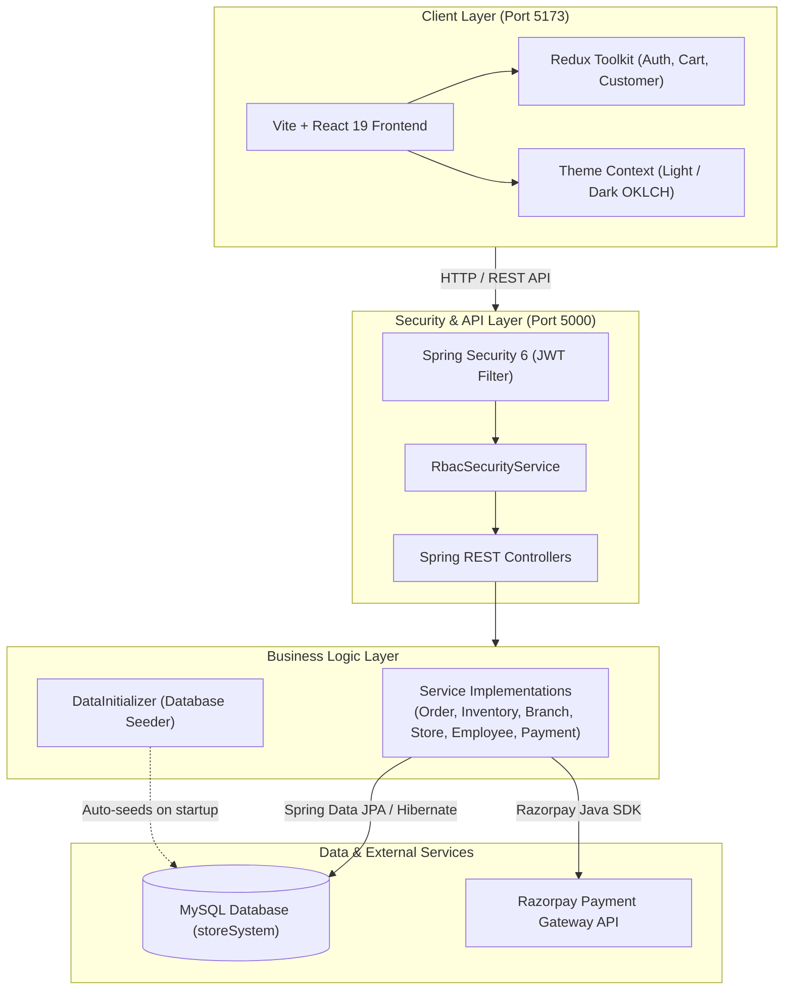

<div align="center">

# ⚡ ZOSH POS SYSTEM

### *Modern Multi-Store Retail Management & Point of Sale Platform*

[](https://spring.io/projects/spring-boot)
[](https://react.dev/)
[](https://vitejs.dev/)
[](https://tailwindcss.com/)
[](https://www.oracle.com/java/)
[](https://www.mysql.com/)
[](https://razorpay.com/)
[](LICENSE)

<br/>

<p align="center">
  <b>A comprehensive, enterprise-grade retail POS solution featuring full multi-store hierarchy, role-based access control (RBAC), real-time inventory tracking, multi-tender payments with Razorpay Dynamic UPI QR, and an interactive high-performance modern UI.</b>
</p>

[Key Features](#-key-features) •
[Architecture](#-system-architecture) •
[Quick Start](#-quick-start) •
[Default Accounts](#-default-demo-accounts) •
[Role Portals](#-role-based-portals) •
[API Reference](#-api-endpoints) •
[License](#-license)

</div>

---

## 🌟 Key Features

<table>
  <tr>
    <td width="50%">
      <h3>🛒 Next-Gen Point of Sale Terminal</h3>
      <ul>
        <li><b>Two-Pane Fast Checkout:</b> Instant SKU and category-based catalog search with real-time stock indicators.</li>
        <li><b>Dynamic Cart Engine:</b> Live calculation of subtotal, configurable tax slabs, coupon discounts, and grand totals.</li>
        <li><b>Customer Directory Integration:</b> Quick lookups, customer selection, credit balances, and one-click creation.</li>
        <li><b>Receipt Printing & Auditing:</b> Printable receipts with thermal printer layout compatibility.</li>
      </ul>
    </td>
    <td width="50%">
      <h3>💳 Multi-Tender Payments</h3>
      <ul>
        <li><b>Razorpay Dynamic UPI QR:</b> Real-time QR generation with auto-polling verification and expiration timer.</li>
        <li><b>Split Payments:</b> Flexible payment tenders (Cash, Card, UPI, Razorpay Gateway).</li>
        <li><b>Instant Refunds:</b> Item-level and whole-order returns with inventory restock automation.</li>
      </ul>
    </td>
  </tr>
  <tr>
    <td width="50%">
      <h3>🏢 Multi-Store & Branch Hierarchy</h3>
      <ul>
        <li><b>Enterprise Store Governance:</b> Multi-tenant architecture supporting chains with unlimited physical branches.</li>
        <li><b>Centralized Master Catalog:</b> Unified master products, variants, and global category taxonomies.</li>
        <li><b>Branch-Level Overrides:</b> Local pricing, floor inventory stock, and contact operational hours.</li>
      </ul>
    </td>
    <td width="50%">
      <h3>🔒 Enterprise RBAC Security</h3>
      <ul>
        <li><b>Stateless JWT Auth:</b> Secure, signed bearer tokens with automatic client credential handling.</li>
        <li><b>4-Tier Role Isolation:</b> Strict method-level security protecting Super Admin, Store Admin, Branch Manager, and Cashier endpoints.</li>
        <li><b>Resilient React Error Boundary:</b> Zero white-screen failure mode with graceful fallback recovery.</li>
      </ul>
    </td>
  </tr>
</table>

---

## 🏗️ System Architecture



---

## 💻 Tech Stack

### Frontend
- **Framework:** [React 19](https://react.dev/) + [Vite 8](https://vitejs.dev/)
- **Routing:** [React Router 7](https://reactrouter.com/) with custom `rr-compat` bridge
- **Styling:** [Tailwind CSS v4](https://tailwindcss.com/) with pure CSS variables & OKLCH color palettes
- **Typography:** `Bricolage Grotesque` (Display / Metrics), `Plus Jakarta Sans` (Body UI), `JetBrains Mono` (Monospace / SKUs)
- **State Management:** [@reduxjs/toolkit](https://redux-toolkit.js.org/) + React-Redux
- **Forms & Validation:** [React Hook Form](https://react-hook-form.com/) + [Zod](https://zod.dev/)
- **Charts & Analytics:** [Recharts 3](https://recharts.org/)
- **Icons & Motion:** [Lucide React](https://lucide.dev/), `tw-animate-css`, custom `CountUp` and `AnimatedText`

### Backend
- **Framework:** [Spring Boot 4.1](https://spring.io/projects/spring-boot)
- **Language:** Java 21 LTS
- **Security:** Spring Security + JWT (`io.jsonwebtoken:jjwt`)
- **ORM / Persistence:** Spring Data JPA + Hibernate 6
- **Database:** MySQL 8.0+ with HikariCP connection pooling
- **Payments:** Razorpay Java SDK (`com.razorpay:razorpay-java:1.4.3`)

---

## 👥 Role-Based Portals

| Role | Default Access Path | Primary Capabilities |
| :--- | :--- | :--- |
| 🛡️ **Super Admin** | `/super-admin/dashboard` | Platform governance, store approvals, system-wide analytics, tenant lifecycle, master workspace switcher |
| 🏬 **Store Admin** | `/store-admin/dashboard` | Branch network management, master product catalog, categories, global employee directory, store reports |
| 📋 **Branch Manager** | `/manager/dashboard` | Branch performance metrics, floor inventory tracking, safety stock alerts, staff management, sales audit |
| 💻 **Cashier** | `/cashier/dashboard` | High-speed POS register, customer lookups, cart building, multi-tender payment processing, shift balance reporting |

---

## 🔑 Default Demo Accounts

All demo accounts come pre-configured and seeded into MySQL on initial server startup.

| Role | Email / Login ID | Password | Portal View |
| :--- | :--- | :--- | :--- |
| **Super Admin** | `admin@zoshpos.com` | `123456` | [Super Admin HQ](http://localhost:5173/super-admin/dashboard) |
| **Store Admin** | `storeadmin@zoshpos.com` | `123456` | [Store Admin Dashboard](http://localhost:5173/store-admin/dashboard) |
| **Branch Manager** | `manager@zoshpos.com` | `123456` | [Branch Manager Dashboard](http://localhost:5173/manager/dashboard) |
| **Cashier POS** | `cashier@zoshpos.com` | `123456` | [POS Checkout Register](http://localhost:5173/cashier/pos) |

> [!TIP]
> On the [Login Screen](http://localhost:5173/auth/login), click any **Demo Accounts** button (*Cashier POS*, *Branch Manager*, *Store Admin*, or *Super Admin*) to automatically populate credentials.

---

## 🚀 Quick Start

### 1. Prerequisites
- **Java 21 LTS:** Verify with `java -version`
- **Node.js (18+ or 20+):** Verify with `node -v`
- **MySQL 8.0+:** Running locally on port `3306`

### 2. Database Setup
Create the MySQL database (or let Hibernate auto-create it):
```sql
CREATE DATABASE IF NOT EXISTS storeSystem;
```

### 3. Environment Configuration
Check `zosh-pos-system/.env` and update credentials if needed:
```env
SERVER_PORT=5000
DB_URL=jdbc:mysql://localhost:3306/storeSystem
DB_USERNAME=root
DB_PASSWORD=12345

RAZORPAY_KEY_ID=rzp_test_TvMAdF6LOl5jK4
RAZORPAY_KEY_SECRET=UW2faQdvhKsDXSg9VvWQfCvj
RAZORPAY_CURRENCY=INR
RAZORPAY_COMPANY_NAME=ZOSH POS Retail

JWT_SECRET=V7mQ2xK9pL4nR8wT6yB3zH5jF1aD0cG7sN9uE2kM4vX8qP6r
```

### 4. One-Click Launch (Windows)
Double-click `start-project.bat` in the project root:
```bat
start-project.bat
```
This automatically boots:
- Spring Boot Backend at **http://localhost:5000**
- Vite React Frontend at **http://localhost:5173**

---

### 5. Manual Terminal Launch

#### Run Backend
```bash
cd zosh-pos-system
# Windows
.\mvnw.cmd spring-boot:run

# Linux / macOS
./mvnw spring-boot:run
```

#### Run Frontend
```bash
cd zosh-frontend-pos-system/zosh-pos-frontend
npm install
npm run dev
```

Visit **http://localhost:5173** in your web browser.

---

## 📡 API Endpoints

<details>
<summary><b>🔐 Authentication & User API</b></summary>

| Method | Endpoint | Description | Access |
| :--- | :--- | :--- | :--- |
| `POST` | `/auth/signup` | Register new user / store owner | Public |
| `POST` | `/auth/login` | Authenticate and obtain JWT token | Public |
| `GET` | `/api/users/profile` | Retrieve logged-in user profile | Authenticated |
| `PUT` | `/api/users/profile` | Update profile information | Authenticated |

</details>

<details>
<summary><b>📦 Products, Categories & Inventory</b></summary>

| Method | Endpoint | Description | Access |
| :--- | :--- | :--- | :--- |
| `GET` | `/api/products/store/{storeId}` | Get store product catalog | Staff |
| `POST` | `/api/products` | Create new product | Admin / Manager |
| `GET` | `/api/categories/store/{storeId}`| List product categories | Staff |
| `GET` | `/api/inventories/branch/{branchId}` | Check real-time stock levels | Staff |
| `PUT` | `/api/inventories/{id}` | Update stock quantities | Admin / Manager |

</details>

<details>
<summary><b>🛒 Orders & Transactions</b></summary>

| Method | Endpoint | Description | Access |
| :--- | :--- | :--- | :--- |
| `POST` | `/api/orders` | Checkout and place new order | Cashier / Staff |
| `GET` | `/api/orders/{id}` | Retrieve order details & receipt | Staff |
| `GET` | `/api/orders/branch/{branchId}` | List orders for a specific branch | Staff |
| `POST` | `/api/orders/{id}/refund` | Process order item refund | Manager / Admin |

</details>

<details>
<summary><b>💳 Payments & Razorpay Integration</b></summary>

| Method | Endpoint | Description | Access |
| :--- | :--- | :--- | :--- |
| `POST` | `/api/payments/razorpay/order` | Initialize Razorpay payment order | Staff |
| `POST` | `/api/payments/razorpay/qr` | Generate dynamic UPI QR code | Cashier / Staff |
| `POST` | `/api/payments/razorpay/verify`| Verify payment signature | Authenticated |

</details>

---

## 📁 Project Structure

```text
zosh-pos-system/
├── start-project.bat                   # 🚀 One-click launcher for frontend & backend
├── .gitignore                          # 🛡️ Clean ignore rules (excludes .env & builds)
├── README.md                           # 📖 Project documentation
│
├── zosh-pos-system/                    # ☕ Spring Boot Java Backend
│   ├── mvnw / mvnw.cmd                 # Maven wrapper binaries
│   ├── pom.xml                         # Spring Boot dependencies & plugins
│   ├── .env                            # Environment variables & DB secrets
│   └── src/
│       ├── main/java/com/zosh/...      # Controllers, Entities, Repositories, Services
│       │   ├── config/                 # SecurityConfig, JwtProvider, DataInitializer
│       │   ├── controller/             # REST API controllers
│       │   ├── model/                  # JPA Entities (Order, Product, Store, User, etc.)
│       │   └── service/                # Business logic implementations
│       └── main/resources/
│           └── application.properties  # Spring application configuration
│
└── zosh-frontend-pos-system/           # ⚛️ Vite + React Modern Frontend
    └── zosh-pos-frontend/
        ├── index.html                  # HTML template with Google Fonts
        ├── vite.config.js              # Vite configuration with Tailwind v4 plugin
        ├── package.json                # Frontend dependencies
        └── src/
            ├── assets/                 # Modern retail photo assets
            ├── components/             # Reusable UI components
            │   ├── cart/               # POS terminal & cart components
            │   ├── common/             # StatCard, Badge, Modal, ErrorBoundary
            │   ├── fx/                 # AnimatedText, CountUp, Spotlight effects
            │   ├── layout/             # Header, Sidebar, breadcrumb navigation
            │   └── payment/            # PaymentModal, RazorpayQrTimer, Success
            ├── layouts/                # AppShell, AuthLayout, Role layouts
            ├── pages/                  # Role dashboard views (admin, cashier, branch, store)
            ├── services/               # Axios API client integrations
            ├── store/                  # Redux Toolkit slices (auth, cart, customer)
            └── index.css               # 580+ lines modern OKLCH design system
```

---

## 🛡️ License

This project is licensed under the [MIT License](LICENSE).

---

<div align="center">
  <sub>Built with ❤️ for modern retail operations and billing efficiency.</sub>
</div>
